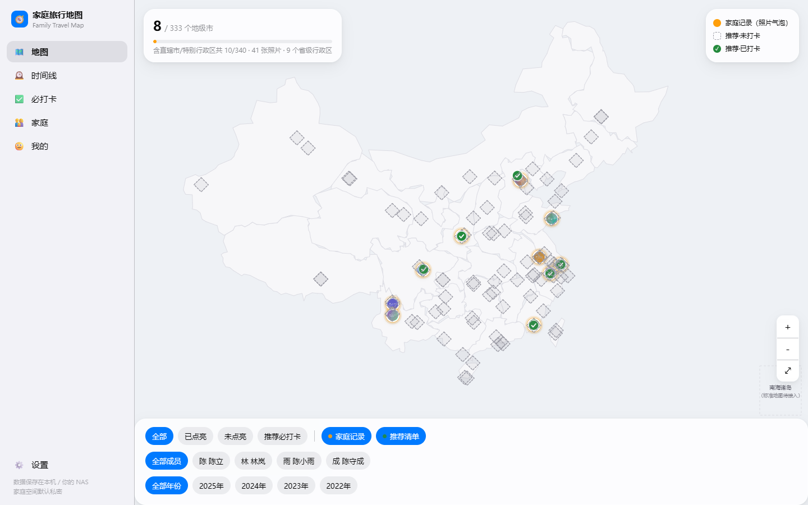
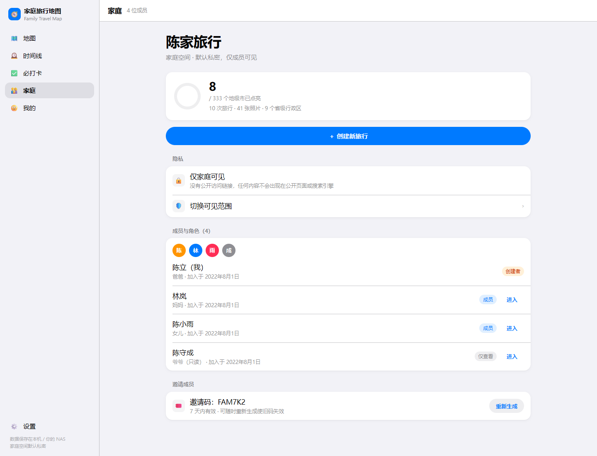

# 🧭 家庭旅行地图 · Family Travel Map

> 把「我们去过哪里」变成一张会点亮的地图。家庭旅行的照片、感想、每人选出的「最佳照片」和必打卡清单，留在你自己的设备上；家庭记录可以部署在自己的 NAS。

`原生 ES Modules` · `无构建` · `零 npm 依赖` · `IndexedDB 本地优先` · `Canvas 中国地图` · `家庭 RBAC`



首次启动会写入一套演示数据：10 次旅行、41 张程序化占位照片、覆盖 9 个省级行政区，地图显示「已点亮 8/333 个地级市」。

## 目录

- [1. 这个项目解决什么问题](#1-这个项目解决什么问题)
- [2. 主要功能](#2-主要功能)
- [3. 安装方法](#3-安装方法)
- [4. 使用方法](#4-使用方法)
- [5. 输入输出示例](#5-输入输出示例)
- [目录结构](#目录结构)
- [数据、隐私与备份](#数据隐私与备份)
- [开发与自测](#开发与自测)
- [上线前必读](#上线前必读)
- [文档索引](#文档索引)

---

## 1. 这个项目解决什么问题

### 真实痛点

- 家庭旅行的记录散落在手机相册、聊天记录和朋友圈里，很难回答「我们去过哪些省、还差哪些地级市」。
- 商业旅行 App 默认把照片上传到云端，鼓励公开分享、榜单排名；家庭照片和孩子的感想并不适合这样处理。
- 普通地图标注只能「打点」，没法把一次旅行的照片、每位成员的感想、各自选出的最佳照片和打卡进度组织在一起。

### 这个项目的回答

- **一张会点亮的地图**：以 340 个点亮单元为骨架（333 个地级行政区 + 4 个直辖市 + 2 个特别行政区 + 台湾省），一次旅行点亮一座城市；同一城市多次旅行自动聚合并让气泡变大。
- **本地优先**：结构化数据与照片默认只存在浏览器 IndexedDB；不注册账号、不上传第三方服务，清空浏览器数据前可用导出功能留档。
- **家庭协作但有边界**：OWNER / MEMBER / VIEWER 三级权限；感想与精选归个人，创建者也不能代写或代选。
- **可以放到自己的 NAS**：零依赖 Node 服务器提供静态托管、健康检查、底图 Token 注入与同步 API；服务端数据就是一个 `family.json`。
- **地图合规**：配置天地图 Token 后使用官方底图并显示审图号；官方瓦片失败时降级为明确标注「非正式」的示意图，不白屏。

### 适合谁

- 想认真记录家庭旅行、又不想把照片交给第三方云服务的家庭。
- 有一台 NAS / 小主机，愿意自己部署一个局域网应用的用户。
- 想阅读「无构建、原生 JS、本地优先 + RBAC + Canvas 地图」完整示例的开发者。

---

## 2. 主要功能

### 功能总览

| 模块 | 能力 |
|------|------|
| 地图主页 | Canvas 绘制中国省界与已点亮城市轮廓；滚轮 / 双指缩放、拖拽、双击放大；已点亮城市显示为照片气泡（同城多次旅行气泡略增大）；推荐景点显示为水滴徽章（已打卡为绿色对勾）；桌面悬停毛玻璃卡、移动端点击弹出底部 Sheet；筛选：全部 / 已点亮 / 未点亮 / 推荐必打卡 × 成员（按旅行创建者）× 年份 × 图层开关 |
| 点亮进度 | 按 `unitId` 去重统计；主指标「已点亮 N/333 个地级市」，副指标「含直辖市/特别行政区共 N/340」；同时显示照片数、省级行政区数、旅行次数 |
| 旅行记录 | 「家庭」页创建旅行（按城市名或省名搜索城市）；标题可留空自动生成；起止日期；具体地点；创建者可编辑，创建者或 OWNER 可删除；删除时照片、感想、精选一并清理 |
| 照片 | 多选上传；浏览器内压缩为最长边 480px 的缩略图与最长边 1600px 的展示图；Canvas 重绘强制剥离 EXIF（含 GPS）；照片墙、查看大图、按上传者权限删除 |
| 感想 | 每位成员每趟一条，独立归属；只有本人能写下/编辑；OWNER 也不能代写；旅行页按成员逐条展示 |
| 我的最佳照片 | 每人每趟最多 3 张；照片右下角 ☆/★ 按钮快选、替换 / 重选、↑↓ 排序；照片 ≥4 张时提供多轮对比 PK 辅助；「家庭精选聚合」只做展示，不做「全家统一评选」 |
| 推荐必打卡 | 内置 96 个人工整理的景点（世界遗产 / 国家级风景名胜区 / 自然奇观 / 古城古镇 / 城市地标）；打卡进度百分比与逐项点亮；支持自定义分组、增删改、恢复预置；同城与 20km 内景点在旅行页提示；VIEWER 只读 |
| 家庭与权限 | OWNER / MEMBER / VIEWER 三级 RBAC；成员资料本人或 OWNER 可改；角色仅 OWNER 可改且必须保留至少一位创建者；成员增删仅 OWNER；移出成员为软移除，内容保留、署名显示「已退出成员」 |
| 邀请 | 6 位邀请码（排除易混淆字符），7 天有效，仅 OWNER 可见 / 生成；输入邀请码 + 姓名即以 MEMBER 身份加入（本地演示流程） |
| 时间线与导出 | 按年倒序时间线；导出家庭旅行册（自包含 HTML，可浏览器打印为 PDF）；导出时间线长图（Canvas PNG，1080px 逻辑宽、2x 像素密度） |
| 搜索 | 本地搜索城市、旅行标题、推荐景点，不上传关键词 |
| 外观与可达性 | 浅色 / 深色主题；标准 / 减少动效；桌面 Rail + 移动 TabBar + 底部 Sheet；空 / 错误状态；深色模式对比度检查（见 `docs/04-acceptance.md`） |
| 底图与合规 | 天地图 `vec_w` + `cva_w` 瓦片；Token 可在设置填写或由服务端 `TIANDITU_TOKEN` 注入；官方模式下地图左下角显示审图号与「© 天地图 自然资源部」；官方瓦片失败时先绘制简化底图并提示；`/api/tile-test` 可区分 Token 无效与域名白名单未放行 |

### 权限矩阵

| 操作 | VIEWER | MEMBER | OWNER |
|------|:------:|:------:|:-----:|
| 浏览内容、导出旅行册 | ✓ | ✓ | ✓ |
| 创建旅行、上传照片、打卡 | ✗ | ✓ | ✓ |
| 编辑旅行 | ✗ | 仅自己创建的 | 仅自己创建的（编辑入口只对创建者显示） |
| 删除旅行、删除照片 | ✗ | 仅自己创建的 / 自己上传的 | 任意 |
| 写感想、选最佳照片 | ✗ | 仅自己的 | 仅自己的（不代写、不代选） |
| 必打卡点增删改、自定义分组 | ✗ | ✓ | ✓ |
| 家庭可见性、邀请码、成员增删、角色变更 | ✗ | ✗ | ✓ |

补充：本人可改自己的姓名 / 家庭关系，OWNER 可改任何成员资料；角色变更只走 OWNER，且降级家庭创建者前必须已有另一位创建者。

### 当前边界（请先阅读）

- **NAS 自动同步尚未接通**：服务端已实现 `/sync/push`、`/sync/pull` 与权威校验，前端 `app/js/core/sync.js` 也提供了客户端；但当前版本在「设置 → NAS 同步」保存地址后不会自动推送或拉取，只有点「测试连接」时才请求 `/api/health`，尚未自动消费本地 op 队列。请勿按「多设备实时同步已可用」预期；纯本地模式功能完整。
- **演示级身份与鉴权**：`X-Member-Id` 请求头可伪造，邀请码 / 成员加入目前是本地演示流程；生产必须加真实登录会话、HTTPS 与反向代理认证。
- **单家庭模式**：一个服务端只服务一个家庭；`/api/bootstrap` 只允许初始化一次，之后返回 409。
- **演示地理数据**：`app/data/*.json` 是简化边界，仅用于点亮与示意，不作为导航或测绘依据；上线需按审图要求接入标准地图服务。
- **照片只在本机**：NAS 模式不会上传照片二进制，照片始终留在各自浏览器的 IndexedDB 中；清空浏览器数据会丢失，重要内容请先导出。

---

## 3. 安装方法

### 3.1 环境要求

- **Node.js 18+**（推荐 20 / 22；Docker 镜像使用 `node:22-alpine`）。服务端只用 Node 标准库，**没有 npm 依赖，不需要 `npm install`**。
- 现代浏览器（Chrome / Edge / Safari / Firefox 近两年版本），需支持 ES Modules、IndexedDB、Canvas 与 `backdrop-filter`。
- 可选：Docker 20+ / Docker Compose v2；Python 3（仅纯静态托管或重新生成地理数据时需要）。

### 3.2 方式一：本机运行（推荐）

```bash
# 进入项目目录
cd family-travel-map

# 启动，默认 http://localhost:8787
node server/server.js
```

改端口：

```bash
# macOS / Linux
PORT=8080 node server/server.js

# Windows PowerShell
$env:PORT=8080; node server/server.js
```

也可以：

- Windows：双击 `start.bat`（需要 PATH 中能找到 `node`）。
- macOS / Linux：`chmod +x start.sh && ./start.sh`。
- 可选：启动时带上天地图 Token，全家默认启用官方底图：

```bash
TIANDITU_TOKEN=你的浏览器端tk node server/server.js
```

### 3.3 方式二：Docker / NAS

```bash
# 构建并启动
docker compose up -d --build

# 可选：注入天地图 Token
TIANDITU_TOKEN=你的浏览器端tk docker compose up -d

# 不使用 compose 时
docker build -t family-travel-map .
docker run -d --name family-travel-map -p 8787:8787 \
  -e TIANDITU_TOKEN=你的浏览器端tk \
  -v "$(pwd)/server/data:/app/server/data" \
  family-travel-map
```

- 数据卷 `./server/data` 保存 `family.json`（家庭、成员、op-log、旅行归属）；备份该目录即备份**服务端**数据，照片与浏览器本地数据不在此列。
- 局域网成员访问 `http://NAS_IP:8787`。公网访问请加 HTTPS 反向代理与访问认证，不要直接暴露 8787。

### 3.4 方式三：纯静态托管（无 Node 服务）

```bash
cd app
python -m http.server 8000
# 打开 http://localhost:8000
```

可用：地图、旅行、照片、感想、精选、打卡、导出与本地存储。
不可用：`/config.json` 的 Token 注入、`/api/tile-test` 诊断、NAS 同步接口。天地图 Token 仍可在「设置 → 地图底图」手动填写。

> ⚠️ 不要直接双击 `index.html`：`file://` 协议下浏览器会拦截 `fetch`，地理数据加载失败。

### 3.5 配置项

| 变量 | 默认 | 说明 |
|------|------|------|
| `PORT` | `8787` | HTTP 端口 |
| `TIANDITU_TOKEN` | 空 | 天地图浏览器端 tk；服务端通过 `/config.json` 注入，前端仅在本地未设置 Token 时采用 |

> 不要把 Token 写进 `start.bat` / `start.sh`、截图或提交到仓库；请用环境变量或「设置 → 地图底图」填写。

### 3.6 验证安装

```bash
curl http://localhost:8787/api/health
```

```json
{"ok":true,"version":"1.0.0","name":"family-travel-map","time":"2026-10-22T02:50:05.000Z"}
```

在没有任何本地数据的浏览器中打开 `http://localhost:8787`，能看到中国地图、顶部「已点亮 8/333 个地级市」和演示家庭，即启动成功。

---

## 4. 使用方法

### 4.1 首次启动：演示家庭

首次打开会自动写入演示数据（只写浏览器 IndexedDB，不写服务端）：

- 家庭「陈家旅行」，4 位成员：陈立（创建者）、林岚（成员）、陈小雨（成员）、陈守成（仅查看）；
- 10 次旅行、41 张程序化占位照片，覆盖 9 个省级行政区；
- 6 条打卡记录；
- 地图显示「已点亮 8/333 个地级市」「含直辖市/特别行政区共 10/340」；
- 邀请码 `FAM7K2`，7 天内有效（可重新生成）。
- 默认未配置天地图 Token，地图使用简化示意底图；在「设置 → 地图底图」填入 tk 后切换为官方底图。
- 演示数据仅用于展示功能；请勿在演示家庭中填入真实个人信息。



**切换身份**（用于体验 RBAC）：

- 「我的 → 多成员演示」点成员首字；或
- 「家庭 → 成员行右侧『进入』」。

切换后界面会按该成员身份刷新。切到 VIEWER（陈守成）时，创建旅行、上传照片、写感想、选片、打卡入口会消失或禁用。

### 4.2 记录一次旅行

1. 打开「家庭」→「＋ 创建新旅行」。
2. 搜索城市（支持城市名或省名，如「杭州」「云南」），点选城市——该城市立即被点亮。
3. 可填写标题、开始 / 结束日期；若城市已点亮，会提示「将聚合为多次旅行」。
4. 点击城市后自动进入旅行详情页。

### 4.3 在旅行详情页补充内容

- **照片**：点「＋ 上传照片」多选图片；上传时自动压缩并剥离 EXIF。照片右下角的 ☆/★ 按钮可快速设为「我的最佳照片」。
- **我的最佳照片**：最多 3 张；「替换 / 重选」打开选择器；↑↓ 调整顺序；照片 ≥4 张时出现「对比 PK 帮我选」，结果只作建议，需本人点「用这 3 张」确认。
- **感想**：只有「我」这一行有「写下 / 编辑」，其他成员的感想只读。
- **附近必打卡**：列出同城景点与 20km 内景点；点开可「标记为已打卡」并关联本次旅行。
- **编辑 / 删除**：旅行创建者可改标题、日期、具体地点；创建者或 OWNER 可删除。删除会一并清理照片、感想与精选。

### 4.4 必打卡清单

- 底部 / 侧边「必打卡」Tab：进度环 + 百分比 + `已打卡 n / 总数`。
- 「按分组 / 按主题」切换；分组可新建、重命名、删除，点可移入 / 移出分组。
- 「＋ 添加必打卡点」「✎ 编辑」「🗑 删除」；误删预置点后可点「↺ 恢复预置(N)」补回。
- MEMBER / OWNER 可编辑，VIEWER 只读；数据来源固定标注为「人工整理·公共常识清单」。

### 4.5 地图操作

- 滚轮 / 双指缩放，拖拽平移，双击放大；右下角 ＋/－/⤢ 控制缩放和回到全国。
- 底部筛选：全部 / 已点亮 / 未点亮 / 推荐必打卡；成员（按旅行创建者）与年份筛选；「家庭记录」「推荐清单」图层开关。
- 桌面悬停气泡可看地点、日期、成员头像、照片数与代表图；点击进入旅行。同城多次旅行会进入城市页（按年分组）。
- 移动端点击气泡弹出底部 Sheet，再进入详情；左上角「‹ 返回」回到来源 Tab。

### 4.6 时间线与导出

- 「时间线」按年份倒序展示，每条含代表图、照片数和一条感想摘要。
- **导出家庭旅行册**：生成自包含 HTML（照片内嵌为 dataURL），在新窗口打开（弹窗被拦截时改为下载）；用浏览器「打印 → 另存为 PDF」得到旅行册。
- **导出时间线长图**：下载 PNG（1080 逻辑宽、2x 像素密度，高度随旅行数量增长）。

### 4.7 设置

- **外观**：浅色 / 深色；设置中另有「跟随系统」选项，但当前版本该选项不会自动切换主题（需要深色请手动选择）；动效：标准 / 减少动效。
- **地图底图**：填写天地图 tk →「保存并启用」；「测试连接」调用 `/api/tile-test`，区分「Token 无效」与「域名白名单未放行」；「如何获取 Token」内附申请与白名单配置步骤。
- **NAS 同步**：填写服务端地址并保存，可测试 `/api/health`；当前不会自动推送 / 拉取 op（见「当前边界」）。
- **危险区**：「清空本地数据」会删除 IndexedDB 与 localStorage 并刷新页面，不可恢复。

### 4.8 备份与迁移

- **浏览器数据**：用「导出家庭旅行册 / 时间线长图」留档（旅行册是摘要，不是完整照片备份）；IndexedDB 与项目目录无关，换浏览器或换设备不会自动带走。
- **服务端数据**：备份 `server/data/family.json`；它只包含服务端的家庭、成员、op-log 与归属信息，不包含照片。
- **部署迁移**：复制整个项目目录与数据卷即可；Node 无依赖，无需重建运行环境。

---

## 5. 输入输出示例

### 5.1 产品级示例：新增一次「广州」旅行

**输入**（家庭 → 创建新旅行）：

| 字段 | 值 |
|------|----|
| 城市 | 广州市（adcode `440100`） |
| 标题 | 早茶两日 |
| 开始日期 | 2026-03-14 |
| 结束日期 | 2026-03-15 |
| 照片 | 5 张手机 JPG |
| 感想 | 每位成员各写一条 |
| 精选 | 每人各选 ≤3 张 |
| 打卡 | 广州塔 |

**输出**（以首次演示数据为起点）：

- **地图**：广州出现照片气泡；进度 `8/333 → 9/333`，副指标 `10/340 → 11/340`，省级行政区 `9 → 10`（新增广东省）。
- **城市页**：广州市下出现「早茶两日」，按 2026 年分组；同城再记录一次时进度不变、气泡略增大。
- **旅行页**：5 张照片进入照片墙；每位成员一条独立感想；「我的最佳照片」显示本人选择；「家庭精选聚合」展示各人选择。
- **必打卡**：广州塔标记为已打卡，必打卡页百分比上升。
- **时间线**：2026 年分组新增一条，含代表图、日期、照片数。
- **本地存储**：IndexedDB 的 `doc` / `photos` / `ops` 更新；照片压成 480px 缩略图 + 最长边 1600px 的展示图，EXIF 已剥离。
- **导出**：旅行册 HTML 新增「广州市 · 早茶两日」章节；时间线 PNG 新增一条。
- **照片数**：演示数据的 41 张 + 5 张 = 46 张。

### 5.2 数据契约：一条旅行记录

创建旅行后写入 IndexedDB 的对象（字段与 `store.createTrip()` 一致）：

```json
{
  "id": "trip_m3k2x9ab",
  "familyId": "fam_demo",
  "title": "早茶两日",
  "unitId": "440100",
  "unitName": "广州市",
  "province": "广东省",
  "placeLabel": "",
  "startDate": "2026-03-14",
  "endDate": "2026-03-15",
  "visibility": "family",
  "createdBy": "m0",
  "createdAt": "2026-10-22T02:50:05.000Z",
  "updatedAt": "2026-10-22T02:50:05.000Z"
}
```

对应的待同步操作（写入 `ops` 仓，等待 `sync.js` 推送；当前版本尚未自动消费该队列）：

```jsonc
{
  "type": "trip.create",
  "payload": { /* 上面的 Trip 对象，完整字段 */ },
  "at": 1792637405000
}
```

### 5.3 HTTP API：请求与响应

以下示例对应 `server.js` 的真实路由与响应结构（以 bash / curl 为例）。服务端是**单家庭模式**，第一次需初始化。

**健康检查**

```bash
curl http://localhost:8787/api/health
```

```json
{"ok":true,"version":"1.0.0","name":"family-travel-map","time":"2026-10-22T02:50:05.000Z"}
```

**首次初始化（只允许一次）**

```bash
curl -X POST http://localhost:8787/api/bootstrap \
  -H 'Content-Type: application/json' \
  -d '{
    "family": {"id":"fam_1","name":"我们家","ownerId":"m0","visibility":"family","inviteCode":"FAM7K2","inviteExpireAt":1793242205000},
    "members": [{"id":"m0","name":"陈立","role":"OWNER"},{"id":"m1","name":"林岚","role":"MEMBER"}]
  }'
```

```json
{"ok":true}
```

再次调用返回 `409`：

```json
{"error":"该服务器已有家庭数据（NAS 单家庭模式）"}
```

**以 m0 身份推送一条感想**

```bash
curl -X POST http://localhost:8787/sync/push \
  -H 'Content-Type: application/json' \
  -H 'X-Member-Id: m0' \
  -d '{"ops":[{"type":"thought.save","payload":{"id":"th_1","tripId":"trip_1","memberId":"m0","text":"早茶很好吃"}}]}'
```

```json
{"ok":true,"results":[{"type":"thought.save","status":200}]}
```

**冒用他人身份写感想 → 422**

```bash
curl -X POST http://localhost:8787/sync/push \
  -H 'Content-Type: application/json' \
  -H 'X-Member-Id: m1' \
  -d '{"ops":[{"type":"thought.save","payload":{"id":"th_2","tripId":"trip_1","memberId":"m0","text":"代写"}}]}'
```

```json
{"ok":false,"results":[{"type":"thought.save","status":422}]}
```

**同一趟旅行提交 4 张精选 → 422（服务端权威上限）**

```bash
curl -X POST http://localhost:8787/sync/push \
  -H 'Content-Type: application/json' \
  -H 'X-Member-Id: m0' \
  -d '{"ops":[{"type":"best.set","payload":{"tripId":"trip_1","memberId":"m0","photoIds":["ph_1","ph_2","ph_3","ph_4"]}}]}'
```

```json
{"ok":false,"results":[{"type":"best.set","status":422}]}
```

**增量拉取 op-log**

```bash
curl 'http://localhost:8787/sync/pull?since=0'
```

```json
{
  "ops": [
    {
      "type": "thought.save",
      "payload": {"id":"th_1","tripId":"trip_1","memberId":"m0","text":"早茶很好吃"},
      "by": "m0",
      "at": 1792637405000
    }
  ],
  "now": 1792637406000
}
```

> `push` 的响应体只包含每条 op 的 `status`，不返回具体拒绝原因；`422` 时 `ok` 为 `false`。同批次中已通过的 op 仍会写入当前进程的 op-log，但本次不触发落盘；若进程在下次成功 push 前退出，这些 op 可能丢失。

### 5.4 服务端落盘：`server/data/family.json`

初始化并推送一条感想后，文件内容形如（时间戳为示例）：

```json
{
  "v": 1,
  "log": [
    {
      "type": "thought.save",
      "payload": {"id":"th_1","tripId":"trip_1","memberId":"m0","text":"早茶很好吃"},
      "by": "m0",
      "at": 1792637405000
    }
  ],
  "updatedAt": 1792637405000,
  "members": [
    {"id":"m0","name":"陈立","role":"OWNER"},
    {"id":"m1","name":"林岚","role":"MEMBER"}
  ],
  "family": {
    "id": "fam_1",
    "name": "我们家",
    "ownerId": "m0",
    "visibility": "family",
    "inviteCode": "FAM7K2",
    "inviteExpireAt": 1793242205000
  },
  "owners": {"trips": {}}
}
```

> 写入有约 200ms 防抖；请在最后一次操作后稍等，再停止服务或复制文件。

### 5.5 启动输出

```text
  🧭 家庭旅行地图 · NAS 服务器
  ─────────────────────────────────
  地址     http://0.0.0.0:8787
  前端目录 /path/to/family-travel-map/app
  数据文件 /path/to/family-travel-map/server/data/family.json
  模式     单家庭 · 家庭空间默认私密
```

---

## 目录结构

```text
family-travel-map/
├── app/                         # 前端（无构建，原生 ES Modules）
│   ├── index.html
│   ├── styles/                  # tokens.css（语义色/圆角/弹簧）+ app.css
│   ├── js/
│   │   ├── main.js              # 外壳 + 路由（5 个 Tab）
│   │   ├── core/
│   │   │   ├── store.js         # IndexedDB 本地优先仓库 + 领域操作
│   │   │   ├── rules.js         # RBAC / 精选上限 / 邀请码 / haversine
│   │   │   ├── sync.js          # NAS 同步客户端（push / pull / health）
│   │   │   └── seed.js          # 演示家庭与程序化占位图
│   │   ├── ui/
│   │   │   ├── kit.js           # 原生组件、Sheet、Toast、图片选择
│   │   │   └── map.js           # Canvas 地图引擎（投影/瓦片/标记/手势）
│   │   ├── views/               # map / trip / unit / timeline / spots / family / me / search / settings
│   │   ├── data/spots.js        # 96 个必打卡点（人工整理）
│   │   └── export.js            # 旅行册 HTML + 时间线 PNG
│   └── data/                    # geo-units.json(340) / geo-provinces.json(34)
├── server/
│   ├── server.js                # 零依赖服务器：静态托管 + API + 权威校验
│   └── data/family.json         # 运行后生成
├── tools/
│   ├── build_geo.py             # 下载并简化省级/地级边界（DataV.GeoAtlas）
│   ├── build_units.py           # 生成 340 个点亮单元
│   ├── test-tile-math.mjs       # 瓦片数学自检（零依赖）
│   └── test-*.js                # Playwright 端到端验收（需自行安装）
├── docs/
│   ├── 01-information-architecture.md
│   ├── 02-components.md
│   ├── 03-data-model.md
│   ├── 04-acceptance.md
│   ├── 05-risk-and-compliance.md
│   └── screenshots/
├── Dockerfile
├── docker-compose.yml
├── start.sh / start.bat
└── README.md
```

---

## 数据、隐私与备份

### 存储位置

- **浏览器 IndexedDB** `family-travel-map`：
  - `doc`：家庭、成员、旅行、感想、精选、打卡、设置等状态快照；
  - `photos`：`photoId → { thumb(最长边 480px), full(最长边 1600px) }`，均为 dataURL；
  - `ops`：待同步操作队列。
- **服务端文件** `server/data/family.json`：家庭、成员、op-log、旅行归属（`owners.trips`）。
- **照片不会上传到 NAS**：目前所有照片二进制只存在上传者的浏览器里。

### 隐私设计

- 家庭空间可见性只有 `family`（仅家庭可见）与 `private`（仅自己可见），**不存在 public**，也没有公开分享链接。
- 上传时用 Canvas 重绘剥离 EXIF（含 GPS），照片元数据标记 `exifStripped: true`。
- 演示照片全部是程序化生成的占位图，不含任何真实摄影作品。
- 无统计脚本、无广告、无第三方数据上报；除启用天地图后请求 `tianditu.gov.cn` 瓦片（或你配置的自定义瓦片服务）外，不向外部服务发送内容。
- 本地搜索不上传关键词。

### 备份建议

1. 定期用「导出家庭旅行册」保存 HTML / PDF，作为文字与精选照片的留档（不是完整照片备份）。
2. 重要照片另外保留原始文件（应用内是压缩后的副本）。
3. NAS 部署时备份 `server/data/family.json`，并把它与项目目录一起迁移。
4. 换浏览器 / 清缓存前先导出，IndexedDB 不会跨设备同步。

---

## 开发与自测

### 零依赖自检

```bash
node tools/test-tile-math.mjs
```

验证经纬度投影与瓦片坐标的往返一致性，不需要浏览器或额外依赖。

### 端到端验收（可选）

`tools/test-spots.js`、`test-basemap.js`、`test-degraded.js`、`test-tile-test.js` 是开发期的 Playwright 脚本，**不在运行时依赖中**：

```bash
# 先启动服务（默认 8787），再按各文件头注释执行
NODE_PATH=<workspace>/node_modules node tools/test-spots.js
```

把 `<workspace>` 换成实际的项目 / 依赖路径；需要自行准备 `playwright-core` 与浏览器，仓库没有 `package.json`，不提供 `npm test`。

### 重新生成地理数据（可选）

```bash
python3 tools/build_geo.py
python3 tools/build_units.py
```

`build_geo.py` 从 DataV.GeoAtlas 下载并简化边界，`build_units.py` 再规整为 340 个点亮单元。两者都会写回 `app/data/`，需要网络。该数据仅为演示用途，生产环境应替换为符合审图要求的来源。

---

## 上线前必读

1. **地图合规**：配置天地图生产环境的浏览器端 tk，把实际访问域名加入白名单；核对审图号批次（默认 `GS(2024)2767号`，以实际申领为准），保持地图左下角的审图号与来源标注。若对地图内容做编辑后公开发布，需按《地图管理条例》送审。详见 `docs/05-risk-and-compliance.md`。
2. **鉴权**：`X-Member-Id` 可伪造，`/api/bootstrap`、`/api/join` 没有真实会话校验；公网部署前必须加登录、HTTPS、反向代理认证与访问控制。
3. **同步能力**：前端尚未自动推送 / 拉取 op；对外不要宣称「多设备实时同步」。如果要做，需要补上 op 队列消费、拉取合并与冲突处理，并先修好推送头里的成员身份来源。
4. **推荐清单**：保持「人工整理 + 来源登记」，不要接入或复刻第三方榜单；用户新增的必打卡点会以「自定义（家庭添加）」来源保存。
5. **数据责任**：照片只在本机，NAS 只备份服务端 JSON；请向家庭成员说明清空浏览器数据的后果，并约定导出 / 备份习惯。

---

## 文档索引

| 文档 | 内容 |
|------|------|
| [`docs/01-information-architecture.md`](docs/01-information-architecture.md) | 信息架构、页面清单、导航结构 |
| [`docs/02-components.md`](docs/02-components.md) | 悬浮卡、详情页等组件拆解 |
| [`docs/03-data-model.md`](docs/03-data-model.md) | 实体字段、权限矩阵、同步 op 协议 |
| [`docs/04-acceptance.md`](docs/04-acceptance.md) | 验收标准（点亮、RBAC、精选上限、底图、必打卡编辑等） |
| [`docs/05-risk-and-compliance.md`](docs/05-risk-and-compliance.md) | 审图号、推荐清单版权、照片隐私风险 |

---

## 许可证

本项目采用 [MIT License](LICENSE) 开源，Copyright (c) 2026 Family Travel Map contributors。
